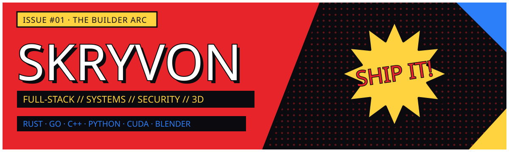

 

  
  
  
  

> [!NOTE]
> **NARRATOR:** I build fast backend services and security tools. I also make 3D animation, shaders, and motion design in Blender.
> Ask me about **Rust, Go, C, C++, Python, system design, or Blender.**

 

| | |
| :--- | :--- |
| 🎮 **CLASS** | Full-stack developer / Systems engineer / Security researcher |
| ⚔️ **MAIN WEAPONS** | Rust, Go, C, C++, Python |
| 🎨 **CUTSCENES** | 3D animation, shaders, and motion design in Blender |
| 🧪 **SIDE QUEST** | GPU computing with CUDA |
| 🏠 **SPAWN POINT** | Arch Linux, every day |
| 🕶️ **STEALTH MODE** | Kali Linux, for security work |

> [!WARNING]
> **RULES OF ENGAGEMENT:** all security work is done through authorized tests and code audits.

 

 

 

  

| ISSUE | YEAR | STORYLINE |
| :---: | :---: | :--- |
| **#1** | **2019** | Wrote my first Python scraping scripts. Switched to Linux for good. |
| **#2** | **2020** | Started 3D animation in Blender. Learned HTML, CSS, and JavaScript. Shipped my first full-stack app. |
| **#3** | **2021** | Began security practice on TryHackMe and Hack The Box. Moved to Arch Linux. |
| **#4** | **2022** | Built web apps with PHP, SQL, and React. Studied reverse engineering with Ghidra and IDA Pro. |
| **#5** | **2023** | Started using Rust, C++, and Go for fast systems code. Published open-source tools. |
| **#6** | **2024** | Worked on distributed systems, CUDA, and API security. |
| **#7** | **2025 → now** | Building in public and shipping open-source tools. |

| ACHIEVEMENT | ORGANIZATION | STATUS |
| :--- | :--- | :---: |
| TryHackMe, top 5% | TryHackMe | 🟢 **ACTIVE** |
| HackTheBox, Pro Hacker | HackTheBox | 🟢 **ACTIVE** |
| AWS Certified Developer | Amazon Web Services | 🏆 **UNLOCKED** |
| Google Professional Cloud Architect | Google Cloud | ⏳ **IN PROGRESS** |
| Kubernetes CKAD | CNCF | 🔒 **LOCKED** (planned) |
| OSCP | Offensive Security | 🔒 **LOCKED** (planned) |

> [!IMPORTANT]
> **COMMISSIONS OPEN.** I take freelance projects, open-source work, and consulting jobs.

| MISSION | SCOPE |
| :--- | :--- |
| 🟥 **Systems and web** | Fast backend systems, REST and gRPC APIs, command-line tools, full-stack web apps. |
| 🟨 **3D and creative** | 3D animation, procedural assets, motion graphics, UI and UX systems. |
| 🟦 **Cybersecurity** | Security design reviews, vulnerability assessments, penetration testing. |

 

 

  

